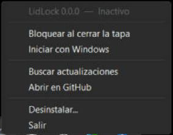

# LidLock

**Bloquea Windows al cerrar la tapa del portátil sin detener tus programas.** · [English below](#english)



## ¿Qué problema resuelve?

Por defecto, al cerrar la tapa de un portátil Windows lo **suspende**: se paran las descargas, los renders, los
servidores locales, la música… Si lo cambias a "No hacer nada", los programas siguen, pero la sesión queda
**abierta y sin bloquear** con la tapa cerrada.

LidLock combina las dos cosas: al cerrar la tapa **bloquea la sesión** (te pedirá tu PIN o contraseña al volver) y
**todo lo demás sigue funcionando**.

## Características

- Icono en la bandeja del sistema con un menú (como TranslucentTB): activar/desactivar, iniciar con Windows,
  buscar y aplicar actualizaciones, abrir el proyecto en GitHub, desinstalar y salir.
- **Muy ligero:** un único `.exe` de ~60 KB, ≈4 MB de RAM y 0 % de CPU en reposo. No usa servicios ni tareas
  programadas.
- **Reversible:** antes de cambiar nada guarda tus ajustes originales y te los devuelve al desactivar o desinstalar.
- **Te avisa antes:** muestra exactamente qué va a cambiar y espera a que aceptes.
- **Actualizaciones:** al iniciar consulta los *releases* de este repositorio; si hay uno nuevo lo ofrece en el menú
  y lo instala verificando su SHA-256.
- Interfaz en español e inglés (según el idioma de Windows).

## Instalación

1. Ve a [**Releases**](../../releases/latest) y descarga `LidLock.exe`.
2. Ábrelo. Verás un mensaje con los cambios que hará; si aceptas, pedirá permiso de administrador **una vez**.
3. Busca el icono del candado junto al reloj (puede estar en el área de iconos ocultos `^`).

> Windows SmartScreen puede avisar de que el archivo es de un "editor desconocido": el exe no está firmado
> digitalmente. Puedes revisar el código fuente de este repositorio y compilarlo tú mismo (ver más abajo).

## Qué cambia en tu PC

| Qué | Dónde |
|---|---|
| Ajuste **"Acción al cerrar la tapa" → No hacer nada** (en todos los planes de energía, con corriente y batería) | Opciones de energía de Windows |
| Tus valores anteriores de ese ajuste | `HKCU\Software\LidLock` |
| Programa | `%LOCALAPPDATA%\LidLock\LidLock.exe` |
| Inicio con Windows | `HKCU\Software\Microsoft\Windows\CurrentVersion\Run` (valor `LidLock`) |
| Acceso en el menú Inicio | `LidLock.lnk` |

Desde el menú del icono:

- **Bloquear al cerrar la tapa** (desmarcar) → restaura tus ajustes anteriores; LidLock sigue en la bandeja.
- **Desinstalar…** → restaura tus ajustes y elimina todo lo de la tabla.

## Cómo funciona

LidLock le pide a Windows que le avise cuando cambia el estado de la tapa
(`GUID_LIDSWITCH_STATE_CHANGE`). El proceso duerme esperando ese aviso y, al cerrarse la tapa, llama a
`LockWorkStation`. No hace *polling* ni consume CPU. Como la acción de la tapa está en "No hacer nada", el equipo no
se suspende.

> Si sales de LidLock con la función activa, el equipo dejará de bloquearse al cerrar la tapa (y tampoco se
> suspenderá). Al salir te pregunta si quieres restaurar tus ajustes.

## Privacidad

La única conexión a internet es consultar `api.github.com` (últimos *releases* de este repositorio) al iniciar y al
pulsar "Buscar actualizaciones". No envía ningún dato tuyo y no hay telemetría.

## Compilar desde el código fuente

No necesitas instalar nada: usa el compilador de C# que ya trae Windows (.NET Framework 4).

```
build.cmd
```

El resultado queda en `build\LidLock.exe`. Estructura:

```
src/            código (Program, TrayApp, PowerSettings, Installer, Updater, Settings, Native, Strings)
assets/         iconos (generados con tools\make-icons.ps1)
build.cmd       compilación local
.github/        flujo que compila y publica cada release
```

Para publicar una versión: crea y sube una etiqueta `vX.Y.Z` (por ejemplo `git tag v1.0.0 && git push origin v1.0.0`);
GitHub Actions compila `LidLock.exe`, genera `LidLock.exe.sha256` y crea el release.

## Licencia

[MIT](LICENSE)

---

<a id="english"></a>

# LidLock (English)

**Lock Windows when you close the laptop lid — without stopping your programs.**

By default, closing a laptop lid makes Windows **sleep**, pausing downloads, renders, local servers and music. Setting
the lid to "Do nothing" keeps them running but leaves your session **unlocked**. LidLock does both: it **locks the
session** when the lid closes and **everything else keeps running**.

**Features:** tray icon with a menu (enable/disable, open at boot, check/apply updates, open on GitHub, uninstall,
exit) · a single ~60 KB `.exe`, ≈4 MB RAM, 0 % CPU when idle · fully reversible (your original settings are saved and
restored) · asks for consent before changing anything · updates itself from this repository's releases (SHA-256
verified) · English and Spanish UI.

**Install:** download `LidLock.exe` from [Releases](../../releases/latest), run it, read the list of changes and accept.
It asks for administrator permission once. The icon appears next to the clock (maybe under the hidden-icons `^`).
Windows SmartScreen may warn because the exe is not code-signed; you can build it yourself with `build.cmd`.

**What changes:** the lid close action is set to *Do nothing* in all power plans; your previous values are stored in
`HKCU\Software\LidLock`; the app lives in `%LOCALAPPDATA%\LidLock`; a `Run` registry value starts it with Windows; a
Start menu shortcut is created. Untick *Lock when the lid closes* to restore your previous settings, or choose
*Uninstall…* to restore them and remove everything.

**Privacy:** the only network access is a request to `api.github.com` to look for new releases. No telemetry.

MIT licensed.
